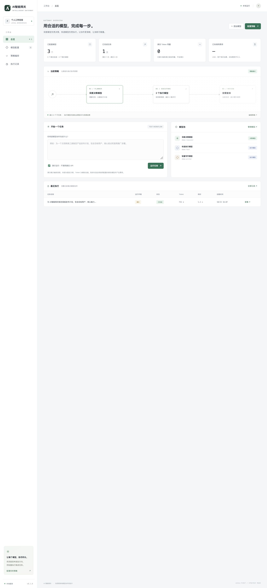

# AI智能网关

一个在 Codex 中表现为**单一 AI 模型**的本地网关：**内部由决策模型和执行模型共同工作**。
模型入口是 `ai-smart-gateway/strategy`，保留系统提示、历史消息、函数工具调用及工具结果。
控制台还提供任务工作台、模型配置、策略设置与调用记录。
GitHub 仓库路径为 `ai-smart-gateway`，项目显示名为“AI智能网关”。



## 快速启动

需要 Node.js 22+。使用锁定依赖的 `js-tiktoken` 在必要时估算长请求容量。

```sh
npm ci --ignore-scripts
npm start
# 浏览器打开 http://127.0.0.1:4317
```

开发时可运行 `npm run dev`。自定义端口用 `PORT=4400 npm start`。
初始三个模型是明确标注的演示配置：可直接运行演示任务，但没有真实智能生成和外部 API 调用。

## 本地 Docker + OpenCodex 双向接入

先确认 Docker Desktop 和本机 OpenCodex 已启动。以下流程读取当前用户的 OpenCodex 运行端口，
不更改其默认渠道，也不会输出密钥：

```sh
node scripts/connect-opencodex.mjs --prepare
docker compose up -d --build --wait
node scripts/connect-opencodex.mjs
```

- 控制台和网关：`http://127.0.0.1:4317`；网关 Base URL 为 `http://127.0.0.1:4317/v1`。
- Docker 使用非 root 用户、只读根文件系统、healthcheck、自动重启及持久命名卷。
  仅将端口发布到宿主机 `127.0.0.1`，不要改成公网映射；容器内监听 `0.0.0.0` 是 Docker 转发所需。
- 容器通过 `host.docker.internal:<OpenCodex端口>/v1` 调用宿主机 OpenCodex。
  OpenCodex 主监听器需要允许 Docker 访问（不能只监听宿主机的 127.0.0.1）。脚本不擅自修改其监听范围。
- 首次接入会导入可见模型（原生别名规范为 `openai/...`，去重后排除本网关），
  创建专用数据面 key，并默认选择已发现的 GPT 决策模型与快速执行模型。
  后续运行不会重写已导入模型的用户配置，也不会重置已配置策略。
- OpenCodex 新增 `ai-smart-gateway/strategy`，显示为“AI智能网关·策略模型”。
  接入通过 OpenCodex 管理 API 完成，变更前备份其配置，不重启正在使用的服务。
- 路径：`OpenCodex → ai-smart-gateway/strategy → Docker网关 → OpenCodex的明确上游模型`。
  网关禁止把 `strategy` 或 `ai-smart-gateway/*` 配为上游，并拒绝带循环标记的入站请求。
- 原生模型 API 支持文本与函数工具：`tools`、`tool_choice`、`parallel_tool_calls`、
  `assistant.tool_calls`、`tool_call_id` 及工具输出；工具由 **Codex 客户端**实际执行，
  网关不执行 shell/浏览器命令，也不会把工具输出当成新的系统指令。
  图片、音频等多模态和其他厂商原生协议尚未适配；不宣称所有插件都已验证。
- `.local/gateway-api-key` 是 Docker secret 的本机源文件，父目录权限为 0700，文件可供
  容器非 root 用户读取；该目录被 Git 和 Docker build 忽略。不要删除此文件后直接重建，
  否则已保存的 OpenCodex 下游认证 key 会失配。需要轮换时应同步更新两端。
- Docker 数据位于 `ai-smart-gateway_gateway-data` 卷，和原来的宿主机 `.data` 目录分别保存，
  原目录不删除。停止使用请执行 `docker compose stop`；不要使用 `down -v`，除非确定要删除运行数据。
- 若要回滚接入，在 OpenCodex 删除新增 provider，并撤销专用 key；不要直接用全量备份覆盖
  之后的其他配置更改。备份位于 OpenCodex home 的 `backups/ai-smart-gateway-*.json`。

桌面服务的控制台可从“模型配置”调整已导入模型，从“策略编排”切换决策/执行角色。
当前最多保存 100 个模型；导入并不等于逐个验证模型额度与可用性。

OpenCodex 同时看得到网关的汇总调用和网关发起的内部模型调用。做 token/费用对照时请只统计
实际上游，排除 `ai-smart-gateway` 汇总记录，避免把同一批 token 重复累计。

## 配置真实模型

1. 进入“模型配置”，添加模型显示名称、模型 ID、API Base URL 和 API Key。
   Base URL 填到 API 前缀（例如 `https://api.openai.com/v1`），不要加 `/chat/completions`。
2. 选择服务商支持的输出参数名 `max_tokens` 或 `max_completion_tokens`。
   不支持 temperature 的模型请将温度留空；支持 JSON 模式的决策模型可勾选 JSON 模式。
3. 按需填写输入/输出单价，单位固定为 **USD / 百万 token**。不内置易过时的型号或定价。
4. 在“策略编排”选择决策模型、一个或多个执行模型、子任务上限与并行度。
   如需复核，选定复核模型并启用。角色可使用同一模型，但真实运行不能包含演示配置。
5. 返回总览，输入任务，**取消“演示运行”**，发起真实调用。真实调用会产生服务商费用。

兼容目标为 Chat Completions 的文本/函数工具协议，并非所有厂商接口的全兼容适配器。
**Codex 通过 OpenCodex 的 Responses 桥接接入**；不要把要求 Responses 协议的客户端直接指向本网关。
目前不直接提供 Responses API，也不提供 Anthropic 原生接口、多模态或自定义 HTTP 头。
可连接采用兼容协议的本机模型服务；非本机 API 要求 HTTPS，不跟随重定向。

## 策略执行逻辑

### 模型 API：原生对话与工具循环

- 简单问题（含天气查询等）直接交给执行模型，不强制调用规划器，也不触发上下文压缩。
- 较复杂的新任务先由决策模型选择执行模型并给出简短执行建议。原始消息和工具定义完整保留，
  不再把整个 Codex 请求展平为一段普通文本。工具结果续接优先沿用同一执行模型。
- 返回工具调用时保留调用 ID、函数名和 arguments，结束原因设为 `tool_calls`。
  Codex 执行工具后，下一次请求中的匹配工具结果继续原对话，不生成伪造天气或执行结果。
- 正常任务不会由网关自动压缩。只有客户端最终用户消息明确携带 Codex 的
  `CONTEXT CHECKPOINT COMPACTION` 协议指令时，才交给决策模型单次生成摘要；不再拆解压缩任务。
  客户端本身仍可能因历史窗口、切换模型或其他策略发起压缩，本网关不会禁用客户端安全机制。
- 通过模型配置的真实窗口选择执行目标；长输入会升级到容量足够的决策模型。
  长请求用 `o200k_base` 估算，小请求采用保守的 UTF-8 字节上界；估算不是各厂商的精确 tokenizer。
  无合适窗口时明确报错，不静默裁剪历史或声称所有快速模型都具有 1M 容量。
- 普通文本最终结果可按配置复核；工具调用与客户端压缩响应不经过复核重写，避免破坏协议。
- 客户端断连会向上游传递取消信号；已经发生的调用仍可能由服务商计费。

### 任务工作台：文本子任务编排

总览中的任务表单（`POST /api/runs`）保留以下文本批处理流程；它不是 Codex 的工具执行循环：

```text
任务 → 决策模型（JSON 计划）→ 按依赖调度执行模型 → 可选复核 → 最终输出
```

- 规划模型输出步骤、执行模型下标和前置依赖，不输出或保存模型私有思维链。
- 最多 8 个子任务，最多 4 路并行，最多同时运行 4 个完整任务。
- 依赖只允许指向前面步骤；独立步骤在并行额度内运行，有依赖的步骤等待前置任务完成。
- 执行模型仅收到当前指令与直接依赖结果，减少整段对话的重复传递。规划器仍需正确保留任务约束。
- 默认将所有最终叶子步骤的结果直接交付；开启复核后，额外调用复核模型整合所有结果。
- 失败任务保留已完成步骤、已知用量和错误。无自动重试、自动降级或无限修复循环，避免意外费用。
- 工作台本身不执行 shell/浏览器/文件操作；只有原生模型工具循环由 Codex 接手真实工具执行。
- 策略模型声明 **1,000,000 token 上下文**，自动压缩阈值 **900,000 token**。
  接入脚本会更新已有网关 provider、该模型专属窗口和该渠道的 context cap，刷新 Codex 模型目录与缓存，
  不改变其他渠道的窗口或默认模型。旧会话仍报窗口错误时，先新开对话并重新选择此模型。
- 网关 HTTP JSON 请求上限 32 MiB，任务文本上限 16 MiB UTF-8 / 8,000,000 UTF-16 单元。
  这些是传输/内存保护，**不是 token 数换算或满窗口可用性的保证**。实际总容量还受决策模型、
  包装提示词、输出预留和上游服务限制；如果更换为小窗口决策模型，不会自动获得 1M 能力。
  决策模型需实际支持目标容量；执行模型并不都具备 1M 窗口。工作台执行器只接收提炼后的步骤与依赖；
  原生工具循环则保留原始历史，按容量选择模型。单次模型响应上限仍为 2 MiB。
- 长任务历史列表只返回 360 单元预览，前端详情轮询使用 `?preview=1` 返回 1,200 单元预览。
  工作台普通 `GET /api/runs/:id` 仍返回完整任务。原生模型记录仅保存任务预览、路由及用量，
  不把整份系统消息、工具结果及供应商 reasoning 状态持久化到记录中。

## 本地网关接口

`GET /v1/models` 返回虚拟模型 `strategy`。
`POST /v1/chat/completions` 支持 system/developer/user/assistant/tool 消息及可选 SSE：

```sh
curl http://127.0.0.1:4317/v1/chat/completions \
  -H 'Content-Type: application/json' \
  -d '{"model":"strategy","messages":[{"role":"user","content":"制定产品发布计划"}]}'
```

必须先完成真实模型与策略配置。网关接口始终真实调用，不接受演示参数。
输出 `usage` 是整次规划、执行、复核的累计服务商用量，而不是最后一次调用的用量。
任一调用缺少 usage 时，累计 usage 为 `null`，不编造数值。`gateway_trace_id` 可对应控制台执行记录。
默认采用面板输出参数。请求可传 `max_tokens` 或 `max_completion_tokens`（1–32768），
作为**每次内部调用**的额外上限，与该模型配置取较小值；不是整次编排的硬预算。
支持 `temperature`、`top_p`、`stop`、`response_format` 及函数工具参数。
`n` 当前只支持 1。未知参数和无匹配工具调用的孤立结果会明确被拒绝。

`stream:true` 使用 SSE：规划/执行期间发送注释保活，模型完成后分块发送文本或工具调用，
以 `[DONE]` 结束；这不是模型逐 token 透传。`stream_options:{"include_usage":true}` 可获取
累计用量事件。OpenCodex 将它桥接为 Responses 的 `function_call` / `function_call_output` 协议，
Codex 负责执行工具。当前仍为缓冲后输出，不是真正逐 token 透传。

可通过环境变量 `GATEWAY_API_KEY` 为 `/v1/*` 设置 Bearer 访问密钥：

```sh
cp .env.example .env
# 编辑 .env，再运行：
node --env-file=.env server/index.js
```

调用者相应提供 `Authorization: Bearer <你的网关密钥>`。真实密钥不能提交到 Git。

## 是否真的省 token、提速？

这是一种可验证的工程假设，不是保证：

- 对可拆分、上下文较短、可并行的任务，使用轻量执行模型有机会降低总费用或延迟。
- 规划、上下文交接和复核也增加 token 与调用次数。简单任务直接调用一个模型可能更高效。
- 便宜的 token 不等于更少的 token；复杂推理也不意味着结果必然更准确。
- 面板明确区分演示与真实记录。演示用量是估值；真实用量仅采用服务商报告，费用仅按你配置的单价估算。
- 尚未实现单模型基线对照，因此不展示“节省了 XX%”一类未经测量的数据。

建议用相同任务与验收条件，比较单一决策模型直出和策略模式的质量、总费用、耗时及人工返工成本。

## 安全与数据边界

- 默认原生监听 `127.0.0.1`；Docker 内可用 `HOST=0.0.0.0`，但必须提供网关 key 并仅发布宿主机回环端口。
  限制 Host 与跨站请求。**控制台没有多用户认证，不要直接暴露到公网或反向代理。**
- 模型密钥通过 AES-256-GCM 加密保存在 `.data/state.json`，主密钥在 `.data/secret.key`。
  目录权限 0700、文件权限 0600。前端不接收明文或密文密钥，更换 API 地址会清除旧密钥，避免误发。
- 主密钥与数据都在同一设备；加密不是对当前系统账号、管理员或磁盘被完整窃取的保护。
  生产环境应换为系统密钥链/独立秘密管理、认证授权、网络隔离与持久数据库。
- 任务与结果明文保存在 `.data`，最多保留最近 100 条已结束记录及活动任务。Git 默认忽略该目录。
  重启时将未结束任务标为失败，不自动重新计费执行。
- 演示完全本地；真实任务内容会发送至你配置的模型服务商。请按该服务商的数据政策选择内容。
- 依赖/工具结果作为数据传递，但提示注入无法靠提示词完全解决；工具权限和确认由 Codex 客户端执行。
- 目前没有请求级硬费用预算、跨进程锁、完整请求队列或审计权限，适合本机单用户原型。

## 验证

```sh
npm run check
npm test
```

测试使用本机模拟服务，不读取真实密钥，不产生模型费用。覆盖加密/脱敏、配置验证、演示标记、
并行调度、依赖传递、复核、真实协议形状、未知用量、错误处理和网关认证。
另有约 6 MB 的长文本测试，确认入口不会被旧的 128 KB / 24,000 字符限制拦截，且内容完整到达
模拟决策服务。这不是实际服务商满 1M token 的质量、延迟或计费测试。

可选择运行**会调用真实模型、可能产生费用**的接入测试，不在 CI 中自动执行：

```sh
node scripts/smoke-native.mjs
node scripts/smoke-native.mjs --codex
```

前者经真实 OpenCodex Responses 接口验证天气函数调用与合成结果回传，不查询或编造真实天气。
后者使用原生 `codex exec` 的只读沙箱读取随机内容的夹具文件，核对实际工具执行与零自动压缩事件。
测试会读取现有专用 admission key 到进程内存，不输出凭据；使用临时会话，不改变默认模型或用户文件。

## 后续方向

- 单模型基线对照、总费用预算与质量评价。
- 逐 token 流式、取消、失败重试预算与可选升级到高能力模型。
- 多协议适配、模型能力标签与按任务类型选择执行模型。
- 生产认证、独立密钥管理与数据库。

MIT License.
